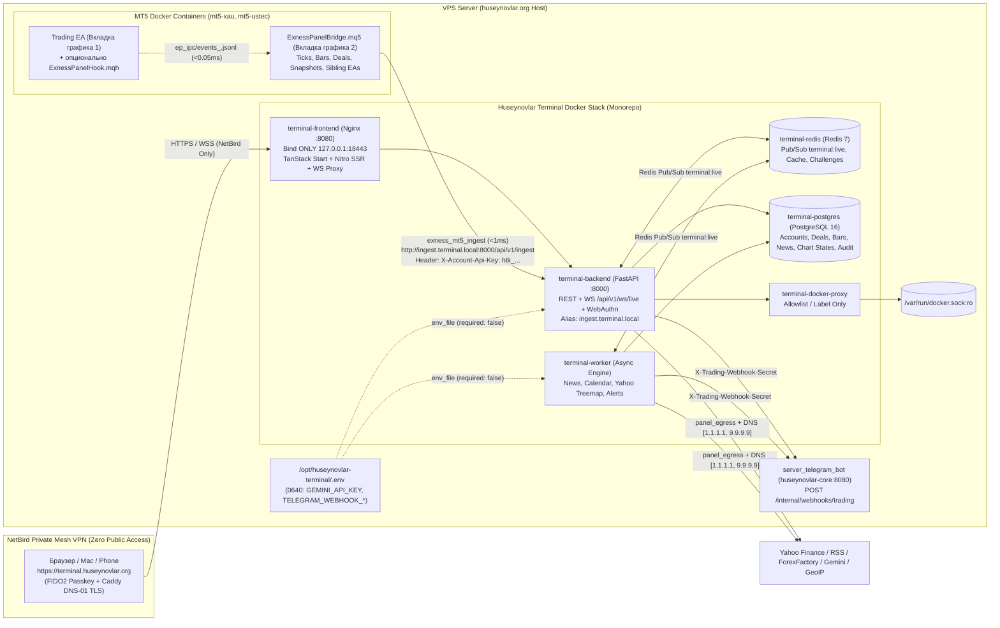

# Мастер-архитектура: Huseynovlar Institutional Multi-Asset Trading & Risk Terminal

> [!NOTE]
> **Версия 2.5 (Production Overhaul M1–M6)** — полная спецификация персонального институционального торгового, телеметрического и аналитического терминала на домене **`https://terminal.huseynovlar.org`**, доступного **исключительно внутри NetBird VPN**.
> Визуальный стандарт: **Bloomberg Terminal compact density** (`tabular-nums`), тема по умолчанию **`tangerine`**, стиль навигации **`floating`**, полная локализация **`RU / EN / AZ`**, 100% серверная персистентность настроек и графиков.

---

## 1. Общая архитектура и сетевая изоляция (Zero Public Exposure)



### Сетевые сегменты (`deploy/docker-compose.yml`)
1. **`panel_internal` (`internal: true`):** изолированная шина для `postgres`, `redis`, `backend`, `worker`, `frontend`.
2. **`panel_egress` (bridge + `dns: [1.1.1.1, 9.9.9.9]`):** исходящий доступ в интернет для `backend` и `worker` (Yahoo Finance котировки/Treemap, RSS-ленты и Verified Sources, ForexFactory календарь, Google Gemini AI, IP GeoIP). Входящих публичных портов нет.
3. **`exness_mt5_ingest` (`external: true`, internal):** выделенная сеть для MT5-контейнеров (`mt5-xau`, `mt5-ustec`). Сервис `backend` зарегистрирован в ней под доменным алиасом **`ingest.terminal.local`** (`http://ingest.terminal.local:8000/api/v1/ingest`). Наличие точки в имени хоста обязательно для прохождения валидации диалога *«Разрешить WebRequest»* в MetaTrader 5 (решает `err=4014`).
4. **`panel_docker_proxy` (`internal: true`):** изолированный канал между `backend` и `tecnativa/docker-socket-proxy` (`CONTAINERS=1`, `POST=1`, `INFO=1`, `NETWORKS=1`).
5. **`huseynovlar_webhooks` (опциональная общая сеть через `setup-vps-integrations.sh`):** связывает `terminal-backend`/`terminal-worker` с контейнером `huseynovlar-core` из репозитория `server_telegram_bot`.

---

## 2. Секреты хоста (`/opt/huseynovlar-terminal/.env`) и Webhook-контракт `server_telegram_bot`

Внешние интеграционные ключи вынесены из UI в файл хоста **`/opt/huseynovlar-terminal/.env`** (права `0640`), который подключается в `terminal-backend` и `terminal-worker` через `env_file` (`required: false`) и читается загрузчиком `backend/app/core/config.py` (с фолбеком на `.env`):

- `GEMINI_API_KEY` / `GOOGLE_AI_API_KEY` + `GEMINI_DEFAULT_MODEL` (`gemini-2.5-flash`).
- `TELEGRAM_WEBHOOK_URL=http://huseynovlar-core:8080/internal/webhooks/trading` + `TELEGRAM_WEBHOOK_SECRET`.
- `IP_GEO_API_URL` (опционально, по умолчанию `http://ip-api.com/json/{ip}`).

> **Почему в панели НЕТ полей `telegram_bot_token` и `telegram_chat_id`:** рассылка в Telegram делегирована выделенному сервису `server_telegram_bot` (`huseynovlar-core`). В `server_telegram_bot/app/common/web.py` путь `/internal/webhooks/trading` внесён в `DEFAULT_AUTH_SKIP_PATHS`, а сам обработчик проверяет заголовок `X-Trading-Webhook-Secret` (совпадающий с `TRADING_WEBHOOK_SECRET`) и отправляет `[TRADING]`-уведомления всем подписанным получателям.

Контракт webhook-запроса:
```http
POST http://huseynovlar-core:8080/internal/webhooks/trading
X-Trading-Webhook-Secret: <TELEGRAM_WEBHOOK_SECRET>
Content-Type: application/json

{
  "title": "Trade Alert",
  "message": "USTEC +$244.00 net profit",
  "severity": "info | warning | critical",
  "source": "huseynovlar-terminal",
  "symbol": "USTEC",
  "account_login": "253752700"
}
```

---

## 3. Архитектура фронтенда: 5-групповая модульная структура и дизайн-система

- **Стек:** TanStack Start + TanStack Router + React 19 + Vite 8 + Nitro SSR + Tailwind v4 + shadcn/ui (`@base-ui/react`) + Zustand + Lightweight Charts v5 + Recharts v3.
- **Системные дефолты (`users.preferences`):**
  - `theme_preset: "tangerine"`
  - `sidebar_variant: "floating"`
  - `density: "bloomberg"` (единственный режим плотности; переключатель Apple удалён)
  - `language: "ru"` (поддерживаются `ru`, `en`, `az` с мгновенным реактивным переключением через `useI18n()`)
  - `timezone: "UTC"`
- **UX-инварианты:**
  - 0 нативных `window.confirm` / `window.prompt` / `alert` — только стилизованные shadcn `AlertDialog` / `Dialog`.
  - Анимированные слева направо shimmer-скелетоны `<Skeleton>` и `<AsyncButton>` со спиннерами на всех асинхронных действиях.
  - Toast-уведомления справа на все CRUD/Auth/Download операции.
  - Единый `LiveSocketProvider` (индикатор `WS LIVE • <N>ms` в шапке), синхронизированные `1000ms` часы рядом с профилем, звуковой отклик при включении звука, same-origin `<AssetLogo>` (`/api/v1/assets/logo/{symbol}`).
  - В `api-client.ts` реализован single-flight перехватчик `401 -> POST /api/v1/auth/refresh -> retry` с мгновенным редиректом на `/auth/v2/login` при протухшей/отозванной сессии.

### 5 навигационных групп (22 выделенных модуля, Full CRUD + Detail View)

| Группа | Маршруты | Назначение |
|---|---|---|
| **1. Терминал (Desk)** | `/dashboard/home`, `/charts` (`/$symbol`), `/accounts` (`new`/`$id`/`edit`), `/profiles` (`$id`), `/robots` (`new`/`$id`/`edit`), `/journal` (`/deals/$dealId`), `/treasury` (`new`/`$opId`/`edit`) | Главная панель, графики с серверным сохранением рисунков, счета Exness, роботы + `.mq5`/`.set`, журнал сделок и Exness Vault |
| **2. Активы и Рынок (Markets)** | `/dashboard/hubs` (`new`/`$code`/`edit`), `/explorer`, `/treemap`, `/analytics`, `/calendar` (`$eventId`) | Хабы активов со сводкой новостей, глобальный поиск + новости в одном окне, 2D Treemap, 8 графиков Risk Lab (с фиксом `USC / 100`), календарь ForexFactory + PnL |
| **3. Новости и ИИ (Intelligence)** | `/dashboard/news` (`$newsId`), `/news/sources` (`new`/`$id`/`edit`), `/ai` (`$briefingId`) | Динамическая лента новостей, БД-реестр проверенных источников с SSRF-защитой, выделенный Google Gemini Co-Pilot |
| **4. Инфраструктура (Operations)** | `/dashboard/containers` (`new`/`$id`/`edit`), `/setup`, `/wiki` (`new`/`$slug`/`edit`) | Управление MT5-контейнерами (`mt5-xau`, `mt5-ustec`), мастер подключения MT5 и `/etc` статус/тесты, Markdown Wiki |
| **5. Система и Доступ (System)** | `/dashboard/users`, `/profile`, `/security`, `/sessions`, `/login-history`, `/audit`, `/preferences`, `/hotkeys` | RBAC-пользователи, профиль, пароль/2FA QR + 10 backup-кодов/Passkeys, сессии, история входов с картой IP, аудит, настройки и макропад `F13–F24` |

---

## 4. Бэкенд, БД-реконсиляция, Real-Time WebSocket и безопасность

### Безопасность и сессии
- **Токены и куки:** `access_token_expire_minutes = 120`, `refresh_token_expire_days = 14`. В JWT access-токен зашит `sid` (`UserSession.id`). Обе куки (`ht_access_token`, `ht_refresh_token`) выставляются с `HttpOnly; SameSite=Lax; Path=/`.
- **Надёжный Logout:** `POST /api/v1/auth/logout` удаляет `UserSession` по `sid` из Bearer/куки И по хешу `ht_refresh_token`, а `get_current_user` валидирует, что `UserSession` не удалена и не истекла.
- **Подписанные загрузки (`?dl_token=`):** `POST /api/v1/auth/download-token` выдаёт токен на 900 сек (`purpose: "download"`), позволяющий скачивать `bridge.set`, `ExnessPanelBridge.mq5`, `ExnessPanelHook.mqh`, `statement.csv` и `statement.xlsx` даже по прямой ссылке в режиме инкогнито.
- **Схема БД (`backend/app/db/schema_sync.py`):** при старте под `pg_advisory_xact_lock(884210)` выполняется идемпотентная реконсиляция таблиц и колонок (`ALTER TABLE ... ADD COLUMN IF NOT EXISTS` + `create_all`), обеспечивая безопасное обновление поверх существующего `terminal_pgdata`.

### Redis Pub/Sub Live Hub (`terminal:live`)
- `worker/main.py` и `backend` публикуют события (`snapshot`, `trade_event`, `bar_update`, `robot_state`, `breaking_news`, `calendar_alert`, `container_event`, `macro_quotes`) в Redis-канал **`terminal:live`**.
- `LiveWebSocketHub` в `backend/app/core/ws_hub.py` транслирует события всем аутентифицированным клиентам `WS /api/v1/ws/live`, выдавая при подключении мгновенный `welcome` (с `server_time_msc` и сводкой портфеля), каждые 10 сек `heartbeat` и `pong` с эхом `client_ts` для расчёта RTT.

---

## 5. Интеграция MQL5 (Zero-Latency Dual-EA Workflow)

1. **Торговый робот** (например, `NasdaqPulse` или XAU EA) работает на **вкладке графика 1** и **не делает сетевых вызовов**.
2. **`ExnessPanelBridge.mq5`** запускается на **отдельной вкладке графика 2** того же символа с загруженным `bridge.set` (в котором уже прописаны `ApiBaseUrl=http://ingest.terminal.local:8000/api/v1/ingest` и расшифрованный `AccountApiKey=htk_...`). Мост автоматически обнаруживает соседние советники через `ChartFirst/ChartNext` и отправляет телеметрию в панель за `< 1 мс`.
3. **Опционально:** добавление `#include <ExnessPanelHook.mqh>` в собственный `.mq5` позволяет передавать расширенную телеметрию (режим стратегии, задержка исполнения, ошибки) через локальный файл `ep_ipc\events_<login>.jsonl` за `< 0.05 мс`.

Подробная пошаговая инструкция по ключам, VPS-скрипту и настройке MT5 находится в [`docs/MT5_AND_KEYS_GUIDE_RU.md`](./MT5_AND_KEYS_GUIDE_RU.md).
