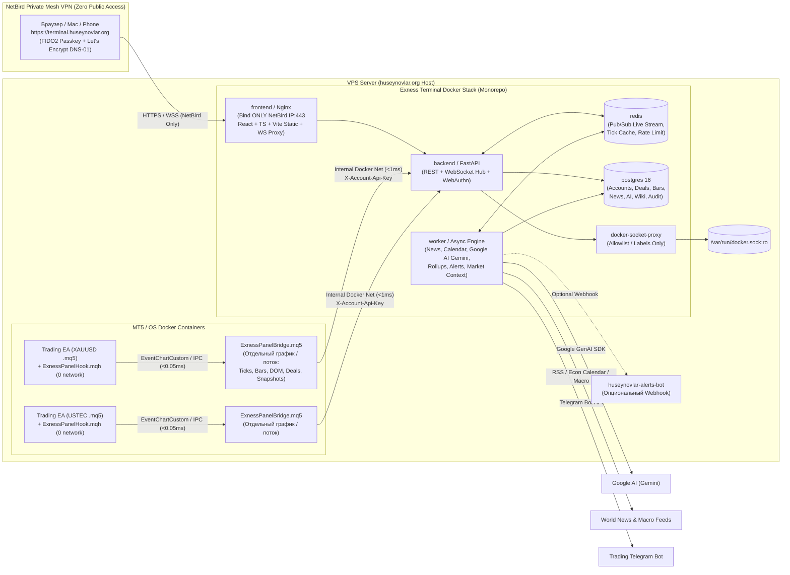

# Мастер-архитектура и дорожная карта: Персональный торговый терминал Exness (Bloomberg × Apple Edition)

> [!NOTE]
> **Версия 2.0** — обновлённая полная спецификация персонального торгового и аналитического терминала для счетов и роботов **Exness (MT5)** на базе поддомена **`huseynovlar.org`**, доступного **исключительно внутри NetBird VPN**.
> Философия продукта: **глубина и мощь Bloomberg Terminal + чистота, интуитивность и кастомизация уровня Apple**.

---

## 1. Общая архитектура и сетевая изоляция (Zero Public Exposure)



### Поддомен `terminal.huseynovlar.org` + NetBird-only + существующий Caddy (авто-TLS для WebAuthn/FIDO2)
Чтобы **FIDO2 / WebAuthn (Passkeys: Face ID, Touch ID, Windows Hello, YubiKey)** работал без единого предупреждения браузера, но при этом сайт был **на 100% невидим из публичного интернета**:
1. Финальный поддомен: **`https://terminal.huseynovlar.org`** (`RP_ID = terminal.huseynovlar.org`).
2. **Private Split-DNS в NetBird + ваш существующий Caddy:** поддомен резолвится только внутри NetBird VPN, а ваш текущий **Caddy** сам выпускает и продлевает валидный TLS-сертификат и проксирует трафик в `terminal-frontend` по внутренней Docker-сети / loopback (`127.0.0.1`). Публичных портов наружу нет вообще.
3. Браузер видит полноценный зелёный HTTPS на `terminal.huseynovlar.org`, и **Passkeys / Face ID / Touch ID работают идеально**.

### Связь с отдельными `docker-compose.yml` контейнеров MT5/ОС
Поскольку каждый MT5/OS-контейнер живёт в своём отдельном `docker-compose.yml`:
* Создаём одну общую внутреннюю Docker-сеть (`docker network create exness_mt5_ingest --internal`) и подключаем к ней `terminal-backend` и нужные MT5-контейнеры — Bridge EA шлёт данные напрямую на `http://terminal-backend:8000` (`< 1 мс`) без выхода в интернет.
* Для безопасного перезапуска из панели на каждый управляемый MT5/OS-контейнер в его `docker-compose.yml` вешаем метку `labels: ["exness-panel.managed=true"]` (плюс явный allowlist в `.env`) — `docker-socket-proxy` видит и перезапускает **только** разрешённые контейнеры.

---

## 2. Репозиторий, Чистая модульная архитектура (Мини-фреймворк) и Docker

### Один монорепозиторий (`exness-terminal`) со своим лёгким Config-Driven мини-фреймворком
Код организован максимально чисто, по доменам и конфиг-файлам, чтобы добавление новой страницы, нового актива, источника новостей или виджета занимало минуты без дублирования кода:
```text
exness-terminal/
├── config/                    # Централизованные YAML/JSON конфиги (дефолты + группировки)
│   ├── assets.default.yaml    # Группы активов (XAUUSD, USTEC, Watchlist), символы, теги
│   ├── news_sources.yaml      # Ленты мировых новостей, RSS/API, веса важности
│   ├── treemap.yaml           # Сектора и тикеры для Market Heatmap (NASDAQ-100, S&P 500, Gold)
│   └── alerts.default.yaml    # Шаблоны правил Telegram-уведомлений
├── backend/                   # FastAPI (feature-sliced модули: router + service + schemas + models)
│   └── app/
│       ├── core/              # Settings, DI, Auth/WebAuthn, Crypto, Registry авто-регистрации модулей
│       └── modules/           # accounts/, assets/, charts/, analytics/, reports/, news/, ai/, containers/, wiki/
├── worker/                    # Фоновый движок (treemap, news, calendar, gemini, alerts, rollups)
├── frontend/                  # React + TypeScript + Vite + выбранный шаблон
│   └── src/
│       ├── framework/         # Наш мини-фреймворк: PageRegistry, WidgetRegistry, HotkeyEngine, Templates
│       │   ├── registries/    # pages.config.ts, widgets.config.ts, hotkeys.config.ts, navGroups.config.ts
│       │   └── templates/     # TerminalPageShell, AssetWorkspaceTemplate, AnalyticsGridTemplate, TableDrawer
│       ├── modules/           # Изолированные фичи по доменам (1 папка = 1 модуль/страница)
│       └── shared/            # API/WS клиент, дизайн-токены, i18n, утилиты USD/USC и таймзон
├── mql5/                      # ExnessPanelBridge.mq5, ExnessPanelHook.mqh, .set генератор
├── deploy/                    # docker-compose.yml, Caddy snippet, nginx/, backup-db.sh (BACKUP_HOST_DIR)
└── docs/                      # Архитектура, runbooks, встроенные шаблоны инструкций
```

**Как работает наш мини-фреймворк на фронтенде:**
* Добавление новой страницы = **1 файл модуля + 1 запись в `pages.config.ts`** (указываете `id`, `group`, `route`, `icon`, `titleKey`, `hotkey`, `component`).
* Страница **автоматически** появляется в левом меню (с поддержкой перетаскивания и скрытия), в `Cmd+K` Command Palette, в редакторе горячих клавиш, в хлебных крошках и в маршрутизаторе — с единым Apple-чистым шаблоном `<TerminalPageShell>`.

### Раздельные Docker-контейнеры в одном `docker-compose.yml`
| Контейнер | Назначение | Изоляция и ресурсы |
|---|---|---|
| `terminal-frontend` | Nginx: статика React/Vite + внутренний роутинг `/api` и `/ws` (за вашим Caddy) | Bind только на `127.0.0.1` / Caddy-сеть, `read_only: true`, ~32–64 MB RAM |
| `terminal-backend` | FastAPI: Ingestion API, Panel REST, WebSocket Hub, WebAuthn | `read_only: true`, `cap_drop: [ALL]`, нет доступа к `docker.sock` |
| `terminal-worker` | Сбор новостей, эконом-календаря, Market Treemap, Google AI (Gemini), алерты, агрегации | Отдельный процесс, чтобы тяжёлые задачи не влияли на live-поток |
| `terminal-postgres` | PostgreSQL 16 (все данные, свечи, сделки, новости, AI-выводы, вики, аудит) | Только внутренняя сеть `internal`, дамп в `BACKUP_HOST_DIR` (Google Drive / `restic`) |
| `terminal-redis` | Redis 7 (Pub/Sub для live-тиков и WS, кэш новостей/тремапа/котировок, rate-limit) | Только внутренняя сеть `internal`, `maxmemory 128mb` |
| `terminal-docker-proxy` | `tecnativa/docker-socket-proxy` для управления MT5-контейнерами | Только `CONTAINERS=1`, `POST=1`, allowlist по Docker label/имени |

---

## 3. Профессиональные графики (`M1`–`W1`), Ордера на графике, DOM и Zero-Latency MQL5

### 3.1. Нулевое влияние на скорость роботов
* Ни один торговый робот не делает сетевых вызовов (`WebRequest()` в MQL5 синхронный и запрещён в торговых советниках).
* **`ExnessPanelBridge.mq5`** работает на **отдельном графике (в отдельном потоке MT5)** и общается с `terminal-backend` по внутренней Docker-сети `exness_mt5_ingest` (`< 1 мс`).
* **`ExnessPanelHook.mqh`** (опциональный include внутрь `.mq5` роботов) передаёт внутренние метрики (версия, пресет, режим стратегии, задержка исполнения в мс, ошибки) локально через `EventChartCustom` / IPC за `< 0.05 мс`.

### 3.2. Графики реального времени, Сделки на графике и Мульти-счета на один актив
* **Точные котировки Exness:** `ExnessPanelBridge.mq5` стримит в панель:
  * **Live-тики** (Bid / Ask / Spread / Last / Tick Volume) раз в 500–1000 мс (или по изменению цены) → Redis Pub/Sub → WebSocket в браузер.
  * **Исторические и live-свечи OHLCV** по всем таймфреймам: **`M1`, `M5`, `M15`, `M30`, `H1`, `H4`, `D1`, `W1`** (подгружаются по запросу из MT5 `CopyRates` и кэшируются в PostgreSQL).
* **Полное отображение торговли прямо на свечном графике:**
  * **Текущие открытые ордера/позиции live:** горизонтальные линии цены входа (`Entry`), `SL`, `TP`, `Breakeven` с живым бейджем лота, счёта (`USD`/`USC`) и плавающего PnL.
  * **История входов и выходов прямо на свечах:** маркеры `BUY`/`SELL` входа и точки выхода, соединительная пунктирная линия сделки (зелёная — прибыль, красная — убыток), всплывающая карточка сделки при наведении (счёт, робот, Net PnL, комиссия, своп, длительность, MAE/MFE).
  * **Синхронизация с таблицей истории ордеров под графиком:** клик по любой сделке в таблице мгновенно прокручивает и масштабирует график точно на свечи входа и выхода этой сделки.
* **Несколько счетов (`USD` + `USC`) на один актив внутри одного профиля Exness:**
  * Архитектура поддерживает **любое количество счетов и роботов на один актив** (например, в одном профиле Exness одновременно `XAUUSD` на счёте №1 `USD` и `XAUUSD` на счёте №2 `USC`, каждый со своими роботами).
  * На графике и в хабе актива работает мгновенный фильтр: **«Все счета по активу вместе (в USD)»** ↔ **«Конкретный счёт (USD или USC)»** ↔ **«Конкретный робот (MagicNumber)»**, с цветовой кодировкой маркеров по счетам/роботам.
* **Спрос и предложение (DOM / Order Book & Liquidity):**
  * Нативный **Depth of Market (`MarketBookGet`)** для символов, где брокер отдаёт стакан;
  * Плюс **институциональный Order Flow / Supply & Demand слой** (работает для всех CFD Exness, включая `XAUUSD` и `USTEC`):
    - **Live Bid/Ask Spread & Pressure Gauge** (скорость и направление тиков, тиковая дельта покупок/продаж);
    - **Session Volume Profile (VPVR / POC / VAH / VAL)** — зоны максимального объёма проторговки;
    - **Авто-зоны спроса и предложения (Supply / Demand Zones + PDH/PDL, Asian/London/NY High-Low)**.
* **Движок графика:** **TradingView Lightweight Charts** (60 FPS canvas, crosshair, индикаторы EMA/VWAP/RSI/ATR, рисование уровней, хоткеи таймфреймов `1`–`8`) + опциональная вкладка с виджетом TradingView для сравнительного теханализа.

---

## 4. Bloomberg × Мировые системы: полный набор модулей

Мы берём лучшие практики из **Bloomberg Terminal**, **Refinitiv Eikon**, **Koyfin**, **TradingView Pro**, **TradeZella / Edgewonk**, **FXBlue** и **QuantConnect**, упаковывая их в чистый интерфейс уровня Apple (простой главный экран → глубокие инструменты по клику или хоткею):

### 4.1. Бегущая строка в шапке (Bloomberg Live News & Market Ticker Tape)
Постоянная настраиваемая бегущая лента в верхней шапке терминала (пауза при наведении мыши, регулировка скорости и состава, можно скрыть в 1 клик):
* **Срочные важные мировые новости (Breaking / High-Impact)** с цветным индикатором AI-сентимента и тегом актива (`[XAUUSD]`, `[USTEC]`) — клик по заголовку сразу открывает карточку с переводом, AI-выжимкой и первоисточником.
* **Обратный отсчёт экономического календаря:** `⚠️ US CPI через 01:14:20 • XAUUSD, USTEC • Forecast 2.9%`.
* **Живые котировки ваших активов и макро-драйверов:** `XAUUSD 2642.50 (+0.84%)` • `USTEC 20845.2 (-0.32%)` • `DXY 104.12` • `US10Y 4.21%` • `VIX 14.8`.
* **Session Clock (`Asia/Baku`):** активные торговые сессии (Tokyo / London / New York + Killzones).

### 4.2. Asset Hubs (Группировка по активам — `XAUUSD`, `USTEC` + Watchlist новых активов)
Для каждого актива вы задаёте: **символы брокера** (`XAUUSD`, `XAUUSDm`, `USTEC`, `US100`), **теги и ключевые слова** (для новостей и AI), **связанные макро-индикаторы** и **цвет/иконку**.
Открыв хаб `XAUUSD` (или `USTEC`), вы на одном экране видите:
1. Живой график `M1`–`W1` + Bid/Ask + DOM / Supply & Demand + **открытые позиции и всю историю входов/выходов роботов прямо на свечах**.
2. Суммарную и раздельную статистику по **всем счетам (`USD` + `USC` одновременно)** и роботам, торгующим этот актив.
3. Синхронизированную таблицу истории ордеров (клик → фокус на графике).
4. Живую ленту мировых новостей по тегам актива + AI-выжимку от Google Gemini + ближайшие High-Impact события календаря.
* **Общая сводка портфеля (Global Overview):** единый экран со сводкой по всем активам, профилям Exness и счетам (`USD` + `USC`, нормализовано в `USD`).
* **Watchlist / Исследование новых активов:** можно добавить любой будущий актив (например, `EURUSD`, `US30`, `BTCUSD`, `USOIL`, `XAGUSD` или акции) ещё **до** подключения счёта/робота — по нему сразу пойдут мировые новости, календарь, AI-обзоры и рыночная карта, чтобы принимать решение о входе в новый актив.

### 4.3. Глобальная карта рынка — Market Treemap Heatmap (как на StockCharts / Finviz)
Интерактивная прямоугольная карта рынка (размер блока = рыночная капитализация/вес, цвет = изменение `%` за `1D`, `1W`, `1M`, `YTD`, группировка по секторам):
* **NASDAQ-100 (`USTEC` драйверы!):** NVDA, AAPL, MSFT, AMZN, META, GOOGL, AVGO, TSLA и др. — мгновенно видно, какие мега-корпорации двигают ваш `USTEC` прямо сейчас!
* **S&P 500 & Top Global Companies:** крупнейшие компании США и мира по секторам (Technology, Financials, Energy, Healthcare, Industrials и др.).
* **Commodities & Gold Ecosystem (`XAUUSD` драйверы!):** Gold, Silver, Platinum, Copper, Crude Oil, Gold Miners (`GDX`, `NEM`, `GOLD`), DXY, US10Y.
* **Интерактивность:** при наведении — цена, `%` изменения, объём и вклад в индекс; при клике — мгновенная карточка с последними новостями по компании/сектору и AI-сводкой влияния на ваши активы.

### 4.4. Мировые новости, Экономический календарь и Google AI (Gemini)
* **Агрегатор мировых новостей:** сбор в реальном времени из RSS и финансовых API (Reuters, FXStreet, Kitco Gold, CNBC, MarketWatch, Investing/ForexFactory calendar, Finnhub/GDELT) с дедупликацией и автоматическим тегированием под ваши активы и Watchlist.
* **Google AI (Gemini) Co-Pilot:**
  * Настраивается прямо в UI (ваш ключ Google AI + выбор модели, например `gemini-2.5-flash` для потока новостей и `gemini-2.5-pro` для глубокого анализа портфеля).
  * **AI News Pulse:** автоматический перевод/выжимка новости на RU/EN, оценка сентимента (`Bullish / Bearish / Neutral`) и `Impact Score (1–10)`.
  * **AI Morning & Evening Briefing:** автоматическая утренняя сводка перед Лондоном/Нью-Йорком и вечерний разбор дня (можно также слать в Telegram).
  * **AI Portfolio & Risk Copilot (чат + кнопка «Проанализировать текущую ситуацию»):** видит ваши открытые позиции, просадку, свежие новости, карту рынка и календарь — отвечает на вопросы и подсвечивает скрытые риски.
  * **AI Trade Post-Mortem:** еженедельный разбор сделок (в какие часы робот теряет, где сильное проскальзывание, как сделки ведут себя вокруг новостей).

### 4.5. Полный отчёт Exness, Аналитика, Риск-менеджмент и Казначейство (Treasury)
* **Бухгалтерия Exness (USD + USC):** автоматический пересчёт центовых счетов (`USC / 100 = USD`), тумблер `USD ↔ Нативная валюта`, поддержка нескольких счетов (`USD` + `USC`) на один и тот же актив внутри одного профиля Exness, точное разделение **Торговой прибыли** (Gross, Commission, Swap, Net) и **Балансовых операций** (`DEAL_TYPE_BALANCE`).
* **Полный отчёт Exness (Full Statement & Export):** формирование детального отчёта за любой период (по профилю, счёту, активу или роботу) с экспортом в **PDF, CSV и Excel** — сводка, кривая эквити, все закрытые сделки, комиссии, свопы, депозиты/выводы/переводы.
* **Раздел «Казначейство / Treasury (Счета + Хранилище Exness)»:**
  * Автоматическая история всех депозитов, выводов, внутренних переводов и переводов в/из Хранилища (Exness Vault) на основе балансовых сделок MT5 + ручные заметки/сверка.
  * Сводка: «В работе на счетах» vs «Выведено в Хранилище/резерв» + автоматический триггер-напоминание о фиксации прибыли в Хранилище.
  * *(Примечание безопасности: переводы денег инициируются вручную в ЛК Exness, панель обеспечивает 100% прозрачный учёт, напоминания и быстрый переход).*
* **Профессиональные метрики:** TWR ROI %, Equity & Balance Curve, Underwater Drawdown, PnL Calendar Heatmap, Profit Factor, Expectancy, Sharpe / Sortino / Calmar, Recovery Factor, Win Rate, Payoff Ratio, Consecutive Wins/Losses, **MAE / MFE**, **TCA (Execution Quality: спред по часам, проскальзывание, задержка исполнения в мс)**.
* **Risk & Correlation Radar:** синхронная просадка по `XAUUSD` + `USTEC`, матрица корреляции, калькулятор стресс-теста маржи, Monte Carlo симуляция просадки.
* **Торговый дневник и аннотации:** автоматические теги сделок (сессия, рядом с новостью High-Impact, спред выше нормы) + заметки прямо на точках графика эквити.

### 4.6. Управление контейнерами и Аварийный Kill-Switch
* **Docker Containers Ops:** статус, uptime, CPU %, RAM MB, логи в реальном времени, кнопки `Restart` / `Start` / `Stop` для allowlisted MT5/OS-контейнеров (через `docker-socket-proxy`, с подтверждением и аудитом).
* **Аварийный Kill-Switch (выключен по умолчанию):** опциональная защита на крайний случай (закрыть позицию / закрыть всё по счёту) — работает **только** если в самом `ExnessPanelBridge.mq5` вручную включено `AllowRemoteClose = true` AND в панели подтверждено через **WebAuthn Passkey / 2FA**.

---

## 5. UX уровня Apple, Персонализация, Профиль и Инструкции

### 5.1. Принцип «Bloomberg внутри, Apple снаружи»
* **Progressive Disclosure:** чистый, воздушный главный экран без визуального шума — самые важные цифры, живой график и статус роботов сразу на виду; глубокие аналитические матрицы, стакан, карта рынка, логи и настройки раскрываются по запросу.
* **Два режима плотности UI:** `Comfortable (Apple)` и `Compact (Bloomberg Terminal)`.

### 5.2. Настраиваемый интерфейс и профиль
* **Конструктор левого меню (Sidebar Customizer):** перетаскивание пунктов (drag-and-drop), скрытие ненужных разделов, закрепление любимых активов (`XAUUSD`, `USTEC`) прямо в сайдбар, сворачивание в узкий icon-rail.
* **Конструктор виджетов и таблиц:** включение/отключение виджетов дашборда, выбор колонок и метрик, сохранение именованных рабочих пространств (Layouts: *Morning*, *Live Charts*, *Analytics*, *Ops*).
* **Личный профиль:** загрузка собственного аватара, имя/роль/био, ссылки на соцсети и контакты (Telegram, X, TradingView, GitHub и др.), настройки языка (`RU`/`EN`, готово под `AZ`), часового пояса (`Asia/Baku` / `UTC` / `Exness Server`) и валюты по умолчанию.

### 5.3. Горячие клавиши и готовность под внешний Макропад (Stream Deck / QMK / Bloomberg Keypad)
* **Command Palette (`Cmd+K` / `Ctrl+K`):** мгновенный доступ ко всем активам, счетам, графикам, карте рынка, контейнерам и действиям с клавиатуры.
* **Редактор горячих клавиш (Visual Keymap Editor):**
  * Полная перенастройка любых комбинаций прямо в UI + импорт/экспорт JSON-профиля.
  * Нативная поддержка расширенных клавиш **`F13`–`F24`** и мульти-модификаторов (`Ctrl+Alt+Shift+...`), которые используются аппаратными макропадами (**Elgato Stream Deck**, **Loupedeck**, **QMK/VIA** кастомные клавиатуры).
  * Каждое действие имеет стабильный `action_id` (например: `asset.open:XAUUSD`, `chart.tf:M5`, `heatmap.open:NASDAQ100`, `privacy.toggle`, `currency.toggle`, `ai.briefing.run`, `container.restart:mt5-xau`, `workspace.switch:live`) — позже можно подключить физические кнопки на столе буквально за 5 минут!
  * Базовые быстрые клавиши: `1`–`8` (таймфреймы `M1`–`W1`), `Shift+M` (Privacy Mode — заблюрить все суммы в `$`), `Shift+C` (`USD ↔ USC`), `Shift+T` (таймзоны), `G D` / `G A` / `G M` (Market Map) / `G N` / `G C` / `G I` (навигация), `?` (интерактивная шпаргалка).

### 5.4. Настройки уведомлений Telegram, Бэкапы Google Drive и Раздел «Инструкции»
* **Центр уведомлений Telegram:** настройка отправки через существующий **`huseynovlar-alerts-bot`** (webhook) и/или отдельный Telegram-бот (Token + Chat ID), гибкие правила (пропал heartbeat, просадка > X%, низкий Margin Level, отключился AlgoTrading, спред > X, High-Impact новость через 15 мин, новый вход в панель, дневной/недельный отчёт + AI-дайджест), «тихие часы» и кнопка `Test Alert`.
* **Интеграция с вашим Google Drive Backup (`restic`):** автоматический ежедневный `pg_dump` (сжатый `.sql.gz` + проверка целостности) складывается в директорию резервного копирования хоста, подхватывается вашим существующим зашифрованным Google Drive бэкапом (`restic`), а статус бэкапа отображается в панели и уходит в Telegram.
* **Интерактивный Setup Wizard + Wiki (Instruction Pages):**
  * Пошаговый мастер подключения нового счёта Exness и нового робота → **автогенерация готового `.set`-файла** для `ExnessPanelBridge.mq5` (с API-ключом и внутренним URL) + bash-команда подключения контейнера к сети `exness_mt5_ingest` + пошаговый чеклист.
  * Встроенная редактируемая **База знаний (Markdown Wiki / Playbooks)** — храните свои обучающие материалы, инструкции по MT5/Exness, параметры стратегий и регламенты действий при ЧП прямо внутри системы.

---

## 6. Безопасность (Institutional Personal Security)

1. **Сетевой периметр:** доступ только через **NetBird VPN** (`terminal.huseynovlar.org` / `trade.huseynovlar.org`) через ваш существующий **Caddy** с авто-TLS (0 публичных портов).
2. **Аутентификация нового поколения:**
   * **FIDO2 / WebAuthn (Passkeys):** вход по Face ID / Touch ID / Windows Hello / YubiKey (можно зарегистрировать несколько устройств — ноутбук, телефон, аппаратный ключ).
   * Резервный вход: пароль (**Argon2id**) + **2FA TOTP** + одноразовые recovery-коды.
   * Короткоживущие JWT + `HttpOnly; Secure; SameSite=Strict` refresh-токены + авто-блокировка экрана по таймеру.
3. **Защита секретов:** все внешние ключи (Google AI, Telegram Bot, опциональный Exness Partner API, news API) шифруются в PostgreSQL через **AES-256-GCM** с мастер-ключом из `.env`. API-ключи счетов MT5 хранятся только в виде SHA-256 хешей и поддерживают мгновенную ротацию.
4. **Приватность и контроль:** `Privacy Mode (Shift+M)`, полный `Audit Log`, мгновенное уведомление в Telegram при входе с нового устройства/IP, строгий allowlist контейнеров в `docker-socket-proxy`.
5. **Опциональный гостевой доступ:** система спроектирована как индивидуальная (Owner-first), но схема БД позволяет при желании выдать ограниченный Read-Only доступ (`VIEWER`) на выбранный счёт/робот.

---

## 7. Дорожная карта (Roadmap)

| Этап | Название | Ключевой результат |
|---|---|---|
| **Фаза 0** | Выбор шаблона, Репо и Caddy/NetBird | Выбор 1 из 2 шаблонов фронта, создание нового приватного монорепо, подключение маршрута в ваш Caddy (`terminal`/`trade.huseynovlar.org`) и базовый Docker Compose стек |
| **Фаза 1** | Фундамент безопасности, Профиль и CRUD | FastAPI + PostgreSQL + Redis, Passkeys (**FIDO2/WebAuthn**) + 2FA TOTP, Профиль (аватар, соцсети), Конструктор левого меню, CRUD профилей Exness / мульти-счетов (`USD`+`USC`) / активов + Watchlist / роботов / API-ключей |
| **Фаза 2** | Zero-Latency MQL5 + Графики, Ордера и DOM | `ExnessPanelBridge.mq5` + `ExnessPanelHook.mqh`, Ingestion API + Redis Pub/Sub + WebSocket, живой график `M1`–`W1` с линиями активных ордеров, историей входов/выходов на свечах (клик из таблицы → фокус на графике), Bid/Ask и DOM / Supply & Demand |
| **Фаза 3** | Глубокая аналитика, Полный отчёт Exness и Казначейство | Хабы активов (`XAUUSD`, `USTEC` с фильтром по `USD`/`USC` счетам) + Global Overview, полный отчёт Exness (PDF/CSV/Excel), Net PnL, TWR ROI, Drawdown, MAE/MFE, TCA, Calendar Heatmap, Risk/Correlation Radar, раздел «Казначейство / Хранилище Exness» |
| **Фаза 4** | Market Treemap (StockCharts), Новости и Google AI | Интерактивная карта рынка (NASDAQ-100 / S&P 500 / Global Top / Gold & Commodities), воркер мировых новостей и эконом-календаря (High-Impact Ticker + Session Clock + Macro Ribbon), интеграция **Google AI (Gemini)**: сентимент, брифинги, Portfolio Risk Copilot, Trade Post-Mortem |
| **Фаза 5** | Docker Ops, Kill-Switch, Telegram, Hotkeys и Wiki | `docker-socket-proxy` (CPU/RAM/Logs/Restart по отдельным MT5 compose-контейнерам), Kill-Switch (opt-in в MT5 + Passkey/2FA), уведомления в `huseynovlar-alerts-bot` / свой TG-бот, редактор горячих клавиш (`Cmd+K` + `F13–F24`), Setup Wizard (`.set` генератор) и Markdown Wiki |
| **Фаза 6** | Тестирование, Hardening, Google Drive Backup и CI/CD | Unit/Integration/Security тесты, нагрузочная проверка WebSocket-тиков, интеграция `pg_dump` с вашим Google Drive `restic` бэкапом, GitHub Actions деплой по NetBird + SSH |

---

## 8. Источники данных (100% бесплатно + Google AI) и стандарты именования

### 8.1. Google AI (Gemini) для вашей подписки
* **Если у вас Google AI Pro / Ultra (основной аккаунт `@gmail.com`):** в [Google AI Studio](https://aistudio.google.com/docs/google-ai-plans) можно **активировать ежемесячные Google Cloud / Gemini API кредиты** (например, \$10/мес на AI Pro, действуют 12 месяцев) и тратить их прямо на API-запросы нашего терминала — плюс на платном API-ключе данные портфеля **не используются для обучения**.
* **Бесплатный Free Tier в Google AI Studio:** доступен вообще без карты (с дневными лимитами RPM/RPD — хватает для базового анализа новостей и брифингов).
* **Провайдер-агностичный слой:** в настройках панели заложим выбор модели и провайдера (`Google Gemini` по умолчанию + возможность позже переключиться на OpenAI / Anthropic / OpenRouter / локальный Ollama).

### 8.2. Бесплатные источники рыночных данных и новостей (0 \$/мес)
| Поток данных | Основной бесплатный источник | Резерв / Кэш |
|---|---|---|
| **Живые графики `M1`–`W1`, тики Bid/Ask, спред, DOM, сделки (`XAUUSD`, `USTEC`)** | **Ваш собственный MT5 Exness** через `ExnessPanelBridge.mq5` (`CopyRates`, `SymbolInfoTick`, `MarketBookGet`) — 100% бесплатно и совпадает пипс-в-пипс с исполнением роботов | Кэш свечей в PostgreSQL + Redis; для Watchlist-активов без MT5 — `yfinance` / виджет TradingView |
| **Market Treemap Heatmap (NASDAQ-100, S&P 500, Global Top, Gold Miners)** | **Yahoo Finance batch (`yfinance`)** — цены `1D/1W/1M/YTD` и капитализации, без API-ключей | Кэш в Redis (обновление каждые 1–5 мин) + Finnhub Free Tier (60 req/min) |
| **Макро-лента (`DXY`, `US10Y`, `VIX`, `SPX`, `EURUSD`, `XAGUSD`)** | **Ваш Exness MT5** (для доступных символов) + **Yahoo Finance** (`^TNX`, `^VIX`, `DX-Y.NYB`, `^GSPC`) | Кэш в Redis (обновление 1–2 мин) |
| **Мировые новости (Breaking + теги по активам)** | Прямые **RSS/Atom ленты** без лимитов: **Kitco News**, **FXStreet**, **CNBC Finance/Tech**, **MarketWatch**, **Federal Reserve Press Releases**, **Google News Finance RSS** + **GDELT 2.0 API** (геополитика для золота) | **Finnhub Free Tier** (корпоративные новости по тикерам NASDAQ-100 / S&P 500) |
| **Экономический календарь (High-Impact: CPI, NFP, FOMC, GDP)** | Публичный JSON-фид **ForexFactory** (`ff_calendar_thisweek.json`) — без ключа, стандарт MT5-трейдеров | Резервный фид **Investing / TradingEconomics RSS** + кэш в PostgreSQL |

### 8.3. Рекомендуемый стандарт именования (в стиле `huseynovlar-*`)
| Сущность | Рекомендуемое имя |
|---|---|
| **GitHub-репозиторий (приватный)** | `huseynovlar-terminal` |
| **Поддомен (внутри NetBird + Caddy)** | `https://terminal.huseynovlar.org` |
| **Директория на VPS** | `/opt/huseynovlar-terminal` |
| **Контейнеры стека терминала** | `terminal-frontend`, `terminal-backend`, `terminal-worker`, `terminal-postgres`, `terminal-redis`, `terminal-docker-proxy` |
| **Общая внутренняя сеть для MT5** | `exness_mt5_ingest` |
| **Docker label для управляемых MT5-контейнеров** | `exness-panel.managed=true` (в их отдельных `docker-compose.yml`) |
| **Нейминг новых MT5-контейнеров (рекомендация)** | `mt5-xauusd-usd`, `mt5-xauusd-usc`, `mt5-ustec-usd`, `mt5-ustec-usc` *(текущие работающие контейнеры переименовывать не обязательно — добавим их имена в `.env` allowlist)* |
